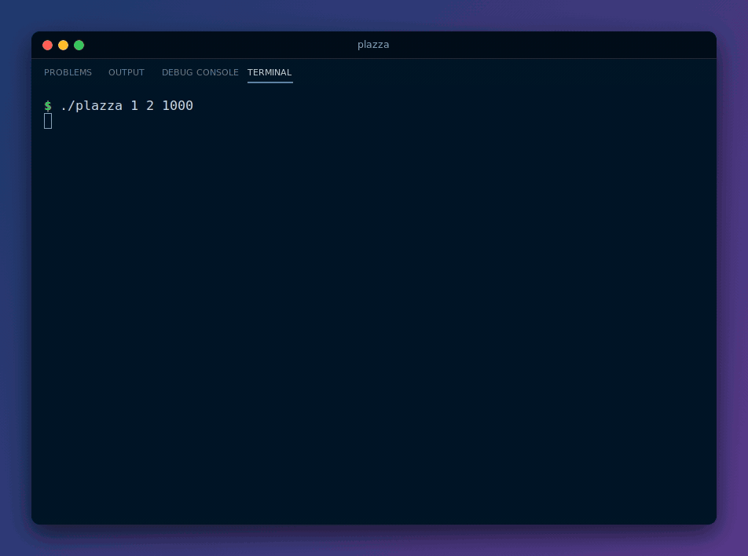
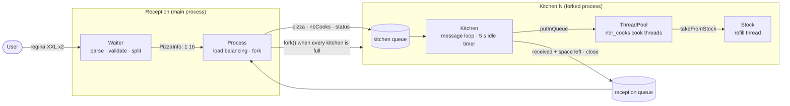

<div align="center">

# The Plazza: a multi-process pizzeria simulation in C++

**A reception shell takes pizza orders and spreads them across kitchens, each one a forked process running its own team of cook threads, all talking through System V message queues.**




[Quick start](#quick-start) · [How it works](#how-it-works) · [Team](#team)

</div>

---

## About

The Plazza is the concurrent programming project of Epitech's second year. The brief: simulate a pizzeria where a **reception** takes orders from the user, and **kitchens**, each a separate process, cook them with a fixed number of **cooks**, each a thread. Kitchens are opened on demand when every existing one is full, share nothing in memory with the reception, and close on their own once they stay idle.

The result is a small interactive shell: type `regina XXL x2; fantasia M x1`, and the pizzas are split one by one across kitchens, cooked in parallel, and announced as they come out of the oven. `status` asks every kitchen for its stock, its busy cooks and the pizzas it is working on.

## Highlights

- **One process per kitchen**: when no kitchen has room left, `Process::createNewProcess` creates a new message queue and `fork()`s a child that builds a `Kitchen` and loops on it. Kitchens are numbered in opening order.
- **IPC with System V message queues**: one queue for the reception and one per kitchen, with keys derived by `ftok`. Every exchange is a request followed by a blocking reply. The C calls (`fork`, `ftok`, `msgget`, `msgsnd`, `msgrcv`, `msgctl`) are wrapped in `Process::CFunction`, which throws a typed `Error` on failure instead of returning `-1`.
- **Compact pizza serialization**: `PizzaInfo` packs an order into two numbers with `operator<<` and unpacks it with `operator>>`, based on the bitmask enums `PizzaType` (`Regina = 1` … `Fantasia = 8`) and `PizzaSize` (`S = 1` … `XXL = 16`). A regina XXL travels as `"1 16"`.
- **Load balancing**: before each pizza, the reception asks every kitchen for its free space (`nbCooks` message) and sends the pizza to the one with the most room. A kitchen accepts at most **2 × cooks** pizzas at once, counting the ones being cooked and the ones waiting in its queue (`ThreadPool::getSpaceLeft`).
- **A thread pool of cooks**: `ThreadPool` keeps a `std::queue<std::function<void()>>` of jobs guarded by a `std::mutex` and a `std::condition_variable`. The cooks sleep until a pizza arrives.
- **Shared stock with a refill thread**: each kitchen starts with 5 of every ingredient. A dedicated thread adds one of each every `<milliseconds>`, up to 5, and wakes the cooks. A cook blocks on a condition variable in `Stock::takeFromStock` until the ingredient is available.
- **Idle kitchens close themselves**: `Kitchen::needToCloseKitchen` tracks the time since the last pizza. After 5 seconds without work, the kitchen answers `close` to the next message, and the reception removes its queue (`msgctl(IPC_RMID)`) and stops sending it work.
- **Menu loaded from a file**: `PlazzaMenu` parses [`plazzaMenu.cfg`](plazzaMenu.cfg) for ingredients, sizes and pizzas (recipe and cooking time). It rejects unknown or duplicate ingredients, duplicate pizzas and missing cooking times.
- **Forgiving shell**: orders are case-insensitive and can be chained with `;`. A line with a bad order is rejected with a message (`Parsing command: Chosen pizza type doesn't exist`) and the shell keeps running.

## Quick start

### Prerequisites

Linux only: the project relies on `fork` and System V IPC, and is built with GCC and libstdc++.

| Tool | Debian / Ubuntu package |
|------|-------------------------|
| g++ with C++20 support, make | `build-essential` |

### Build and run

```bash
git clone https://github.com/yanishk/theplazza.git
cd theplazza
make                    # builds ./plazza
./plazza 0.5 2 1000
```

Run it from the repository root: the menu is read from `./plazzaMenu.cfg`, and the queue keys are derived with `ftok` from files under `src/`.

| Argument | Meaning |
|----------|---------|
| `<multiplier>` | Scales every cooking time (`0.5` = twice as fast). Can be a decimal. |
| `<nbr_cooks>` | Number of cooks (threads) per kitchen. |
| `<milliseconds>` | Time between two stock refills. |

All three must be strictly positive, otherwise the program prints an error and exits with code 84. `make clean`, `make fclean` and `make re` work as usual.

### Ordering

An order is `TYPE SIZE xNUMBER`, and several orders can be chained with `;`:

```
regina XXL x2; fantasia M x1; margarita S x5
```

| Pizza | Ingredients | Base cooking time |
|-------|-------------|-------------------|
| `regina` | dough, tomato, gruyere, ham, mushrooms | 1 s |
| `margarita` | dough, tomato, gruyere | 1 s |
| `americana` | dough, tomato, gruyere, steak | 2 s |
| `fantasia` | dough, tomato, eggplant, goat cheese, chief love | 4 s |

Sizes are `S`, `M`, `L`, `XL` and `XXL`. Type `status` to print the state of every open kitchen, and press Ctrl+D to leave.

Recipes and cooking times can be changed in `plazzaMenu.cfg`. A new pizza name or size also needs an entry in the `PizzaType` / `PizzaSize` enums of [`src/Pizza/PizzaInfo.hpp`](src/Pizza/PizzaInfo.hpp), since that is what goes over the queues.

### Sample session

With `./plazza 0.5 2 1000` (2 cooks per kitchen, stock refilled every second):

```
regina XXL x2; fantasia M x1
status
Kitchen 1 {
	Ingredients {
		chieflove: 5
		dough: 3
		eggplant: 5
		goatcheese: 5
		gruyere: 3
		ham: 3
		mushrooms: 3
		steak: 5
		tomato: 3
	}
	Number of pizzas in work: 2
	Number of available cooks: 0
	Space left for pizzas: 1
	Pizzas being worked on {
		regina XXL
		regina XXL
		fantasia M
	}
}

calzone L x1
Parsing command: Chosen pizza type doesn't exist
Kitchen 1: One regina in size XXL comin' right up
Kitchen 1: One regina in size XXL comin' right up
Kitchen 1: One fantasia in size M comin' right up
```

Both cooks of kitchen 1 are on the reginas while the fantasia waits in the queue. With 2 cooks, the kitchen can still take one more pizza before the reception has to open a second one.

## How it works



For every pizza of an order, the reception polls each open kitchen through its queue. A kitchen answers on the reception queue with its free space, or with `close` if it has been idle for more than 5 seconds. The pizza goes to the kitchen with the most room, or to a freshly forked one if they are all full. Inside the kitchen, the pizza becomes a job in the thread pool. A cook takes the ingredients from the stock (waiting for a refill if needed), sleeps for the cooking time × multiplier, then prints the result. Kitchens write to the same terminal as the reception, so the cooking messages and `status` reports come straight from the kitchen processes.

```
main.cpp              Argument check, entry point
src/Arguments.*       Command-line parsing and validation
src/Waiter.*          Reception shell: order parsing, validation, dispatch
src/Process.*         Kitchen forking, message queues, load balancing
src/ProcessFunc.cpp   Throwing wrappers around fork and the System V IPC calls
src/Kitchen.*         Kitchen loop, idle timeout, status report
src/ThreadPool.*      Cook threads and job queue
src/Stock.*           Ingredient stock and refill thread
src/PlazzaMenu.*      plazzaMenu.cfg parser
src/Pizza/            Pizza recipe and cooking, PizzaInfo serialization
include/Error.hpp     Base exception class
plazzaMenu.cfg        Ingredients, sizes and recipes
```

## Team

Built in under two weeks (May 2024) by three Epitech students:

| | Main areas |
|---|---|
| [**Yanis Harkouk**](https://github.com/yanishk) | Reception shell (order parsing and validation), menu file parser and `plazzaMenu.cfg`, `PizzaInfo` serialization, `Kitchen` class and its link to the thread pool, pizza cooking logic, stock condition variable, error classes, IPC and kitchen-timer fixes |
| [**Eva Legrand**](https://github.com/Chaegnal) | Initial architecture (arguments, shell loop, Makefile), thread pool, stock and refill thread, `status` command, load balancing on free space, cooking messages, IPC logic fixes |
| [**Mathis Brehm**](https://github.com/mathisbdkr) | System V message-queue IPC between the reception and the kitchens, kitchen forking, closing idle kitchens after 5 seconds, throwing wrappers for the C system calls |

## License

Educational project (Epitech, 2024).
